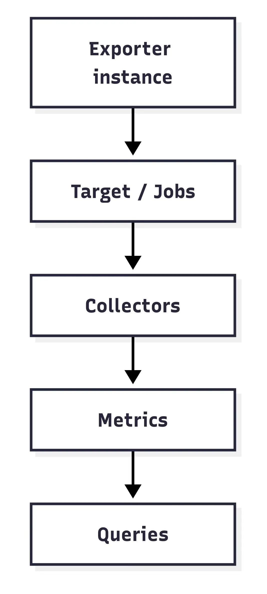

# Architecture

  

Execution flows down the hierarchy, and result rows flow back up to become samples on `/metrics`.

1. **Exporter → (Jobs) → Targets**:

   **Exporter** is the top-level struct. It contains global settings, and either a list of **Jobs** or a single **Target**.
   Each entry in a **Job** target list resolves into a dedicated **Target**.

   Target and jobs modes are mutually exclusive and cannot work together.

1. **Targets → Collectors**:

   Each **Target** has its own connection string, and an attached list of **Collector** references.

1. **Collector → Metrics**:

   **Collector** might hold multiple **Metrics**. The cache parameter applies at the collector level.

1. **Metrics → Queries**:

   **Metric** defines a **Query** to be executed on the target database, and the mapping rules to convert the query
   result into Prometheus metrics.

1. **Queries**

   **Query** is the minimal unit of execution. It is executed once per scrape, and the result is mapped to one or more
   metrics.

   The query can be defined as a part of the **Metric** using the `query` field, or may be referenced by name at the
   `query_ref` field.

   For better clarity, please inspect the configuration page and available examples.
